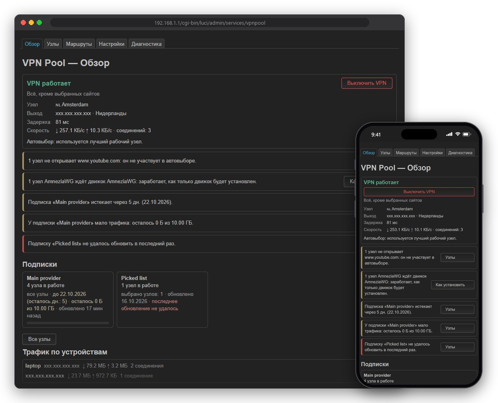
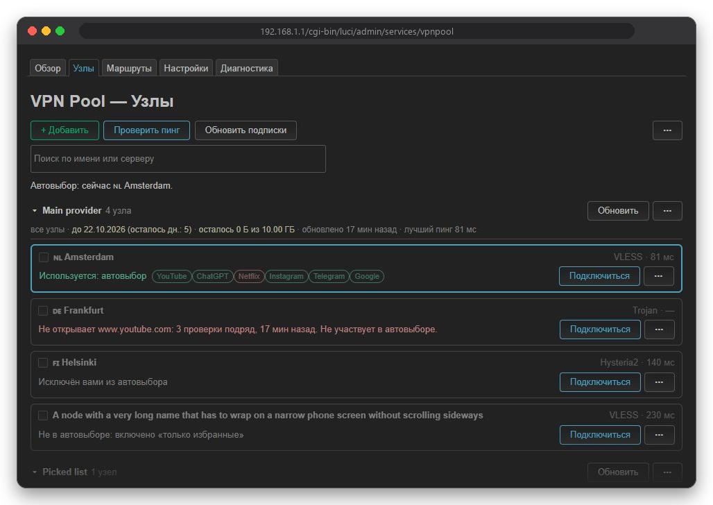
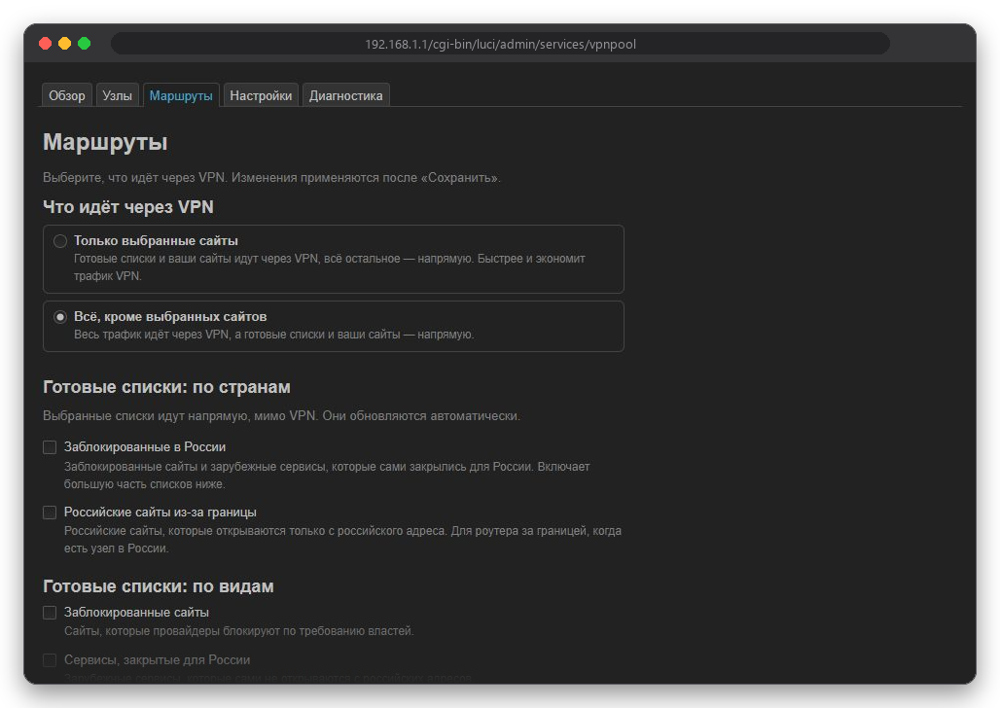
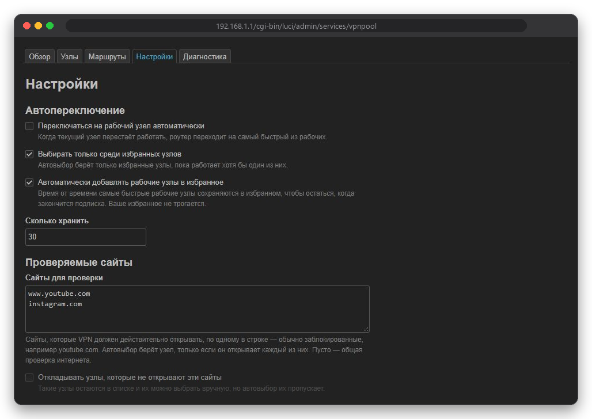
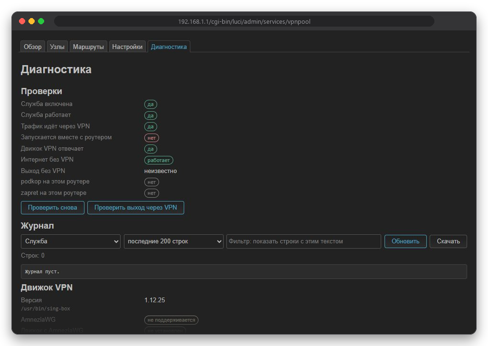
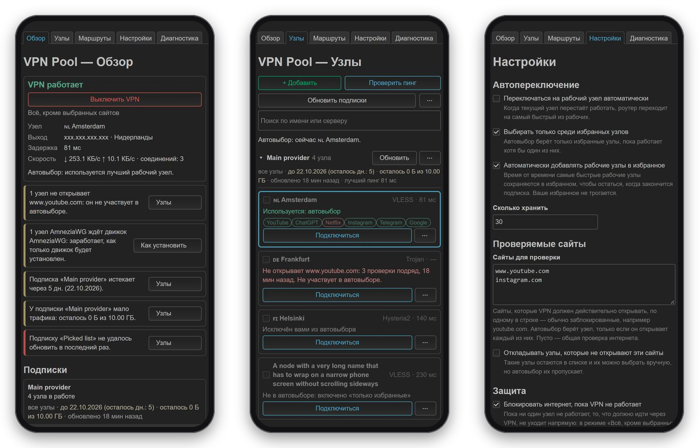

<p align="center">
  
</p>

<h1 align="center">VPNpool</h1>

<p align="center">
  <b>VLESS / Reality / Hysteria2 / AmneziaWG subscription manager with auto-failover for OpenWrt</b><br>
  Like v2RayTun or Happ — but on your router.
</p>

<p align="center">
  <a href="https://github.com/roman-png/VPNpool/releases/latest"></a>
  <a href="https://github.com/roman-png/VPNpool/actions/workflows/build.yml"></a>
  
  
  <a href="LICENSE"></a>
</p>

<p align="center">
  <a href="#-install">Install</a> ·
  <a href="#%EF%B8%8F-quick-start">Quick start</a> ·
  <a href="#-screenshots">Screenshots</a> ·
  <a href="#-features">Features</a> ·
  <a href="#-reference">FAQ</a> ·
  <a href="README.ru.md">Русский 🇷🇺</a>
</p>

<br>

<p align="center">
  
</p>

vpnpool keeps your whole VLESS / Reality subscription as a pool, checks every node against
the services *you* need, and switches to a working one by itself. AmneziaWG nodes join the
same pool. Managed from LuCI, a Telegram bot or plain `uci`.

```sh
sh <(wget -O - https://raw.githubusercontent.com/roman-png/VPNpool/main/install.sh)
```

<sub>One command for every OpenWrt: `.apk` on 25.12+, `.ipk` on 23.05 / 24.10 — the installer picks the format itself. More options in [Install](#-install).</sub>

**Protocols:** VLESS (Reality + Vision) · VMess · Trojan · Shadowsocks · Hysteria2 · TUIC · XHTTP · sing-box JSON · AmneziaWG 1.x–3.1

---

## ✨ Highlights

<table>
<tr>
<td width="50%" valign="top">🎯 <b>Checks what matters</b><br>A node is "working" only if it opens <i>your</i> services (e.g. YouTube) — not just answers a ping</td>
<td width="50%" valign="top">🔀 <b>Auto-failover</b><br>urltest + end-to-end watchdog; the dead active node is replaced automatically</td>
</tr>
<tr>
<td valign="top">🚦 <b>Fail-safe</b><br>The LAN is never routed into a dead tunnel — no working node, internet stays direct</td>
<td valign="top">📡 <b>Subscriptions</b><br>Auto-update, several subscriptions in one pool, multi-client User-Agent probing</td>
</tr>
<tr>
<td valign="top">🧭 <b>Routing</b><br>Only selected sites or everything-except, 24 community lists, per-device rules</td>
<td valign="top">🛡️ <b>Leak protection</b><br>IPv6 guard, kill-switch, DNS-leak guard, TLS-fragment anti-DPI</td>
</tr>
<tr>
<td valign="top">🤖 <b>Telegram</b><br>Alerts + two-way bot with a button menu, works where Telegram is blocked</td>
<td valign="top">📟 <b>Small routers</b><br>Runs on 16 MB flash — sing-box lives in RAM</td>
</tr>
<tr>
<td valign="top">🧬 <b>AmneziaWG</b><br>Obfuscated WireGuard in the same pool, with the same check and failover</td>
<td valign="top">🤝 <b>Coexists</b><br>With podkop and zapret: separate marks, tables, ports</td>
</tr>
</table>

---

## 📸 Screenshots

<table>
<tr>
<td width="50%" align="center" valign="top">
  <a href="docs/screenshots/nodes.jpg"></a><br>
  <b>Nodes</b><br><sub>Subscriptions, delay, the node in use, which services each node opens</sub>
</td>
<td width="50%" align="center" valign="top">
  <a href="docs/screenshots/routes.jpg"></a><br>
  <b>Routes</b><br><sub>Selected sites or everything except them, ready-made lists, devices</sub>
</td>
</tr>
<tr>
<td width="50%" align="center" valign="top">
  <a href="docs/screenshots/settings.jpg"></a><br>
  <b>Settings</b><br><sub>Failover, the services to check, protection, Telegram, timetable</sub>
</td>
<td width="50%" align="center" valign="top">
  <a href="docs/screenshots/diagnostics.jpg"></a><br>
  <b>Diagnostics</b><br><sub>Checks, log with a filter, engine version, technical parameters</sub>
</td>
</tr>
<tr>
<td colspan="2" align="center">
  <br>
  <b>On a phone</b><br><sub>The same five tabs, laid out for a narrow screen</sub>
</td>
</tr>
</table>

<p align="center"><sub>Demo data on the test stand (made-up nodes, addresses hidden). The interface follows the LuCI language and theme. Click a picture for the whole page.</sub></p>

---

## 🚀 Install

**Requirements:** OpenWrt **25.12+** (apk) or **23.05 / 24.10** (opkg), **≥ 128 MB RAM**,
~40 MB free flash for sing-box (+ ~45 MB for the [AmneziaWG engine](#-amneziawg-engine) if you use AmneziaWG) — or
[16 MB flash with sing-box in RAM](#-routers-with-small-flash-16-mb).
Our packages are architecture-independent; sing-box and kmods come from your router's feeds.

| Variant | Command |
|---|---|
| **Standard** | `sh <(wget -O - https://raw.githubusercontent.com/roman-png/VPNpool/main/install.sh)` |
| **+ AmneziaWG** | `VPNPOOL_AWG=1 sh <(wget -O - https://raw.githubusercontent.com/roman-png/VPNpool/main/install.sh)` |
| **16 MB flash** | `VPNPOOL_RAM_SINGBOX=1 sh <(wget -O - https://raw.githubusercontent.com/roman-png/VPNpool/main/install.sh)` |

The same command **updates** an existing install; `/etc/config/vpnpool` is kept. If your
`wget` can't do `<(...)`: `wget -O /tmp/i.sh https://raw.githubusercontent.com/roman-png/VPNpool/main/install.sh && sh /tmp/i.sh`.

<details>
<summary><b>Installer options</b></summary>

| Variable | Effect |
|---|---|
| `VPNPOOL_AWG=1` | Also install the AmneziaWG engine ([vpnpool-engine](https://github.com/roman-png/vpnpool-engine), sha256-pinned) as a separate file `/usr/bin/sing-box-awg`; the stock sing-box stays as it is. `VPNPOOL_AWG=update` updates it |
| `VPNPOOL_RAM_SINGBOX=1` | 16 MB flash: sing-box in RAM, reinstalled on every boot |
| `VPNPOOL_VERSION=v2.0.0` | A specific release instead of `latest` (`.apk` from v1.5.0 on) |
| `VPNPOOL_PKG_DIR=/tmp/vpnpool` | Install package files you already copied there — no GitHub download |

Downloads are retried 4× and fall back to the [GitHub Pages mirror](https://roman-png.github.io/VPNpool).
podkop keeps using the stock `/usr/bin/sing-box`: the AmneziaWG engine is a separate file.

</details>

<details>
<summary><b>Manual install from Releases</b></summary>

Each [release](https://github.com/roman-png/VPNpool/releases/latest) carries both formats:

```sh
# OpenWrt 25.12+ (apk)
apk update && apk add --allow-untrusted ./vpnpool-*.apk ./luci-app-vpnpool-*.apk ./luci-i18n-vpnpool-ru-*.apk
# OpenWrt 23.05 / 24.10 (opkg)
opkg update && opkg install ./vpnpool_*_all.ipk ./luci-app-vpnpool_*_all.ipk ./luci-i18n-vpnpool-ru_*_all.ipk
```

`--allow-untrusted` is needed because a single file isn't covered by a feed signature. The
`luci-i18n-vpnpool-ru` package is the Russian interface (the language follows the LuCI setting).

</details>

<details>
<summary><b>Signed package feed</b> — upgrades together with the system</summary>

```sh
# OpenWrt 25.12+ (apk)
wget -O /etc/apk/keys/vpnpool-apk.pem https://roman-png.github.io/VPNpool/apk/vpnpool-apk.pem
echo "https://roman-png.github.io/VPNpool/apk/packages.adb" >> /etc/apk/repositories.d/customfeeds.list
apk update && apk add luci-app-vpnpool

# OpenWrt 23.05 / 24.10 (opkg, usign key 807479500e0ce219)
wget -O /etc/opkg/keys/807479500e0ce219 https://roman-png.github.io/VPNpool/vpnpool-feed.pub
echo "src/gz vpnpool https://roman-png.github.io/VPNpool" >> /etc/opkg/customfeeds.conf
opkg update && opkg install luci-app-vpnpool
```

Signature checking stays on. A package installed from a *file* is pinned to it, so
`apk upgrade` / `opkg upgrade` won't update it — re-run the installer, or use this feed.

</details>

<details>
<summary><b>Build from source (OpenWrt SDK)</b></summary>

```sh
# inside an OpenWrt SDK: 25.12 -> .apk, 24.10 -> .ipk (same Makefiles)
git clone https://github.com/roman-png/VPNpool package/vpnpool-src
./scripts/feeds update -a && ./scripts/feeds install -a
make package/vpnpool/compile package/luci-app-vpnpool/compile V=s
```

CI builds both formats for aarch64_cortex-a53, x86_64 and mipsel_24kc and attaches them to releases.

</details>

---

## ⚙️ Quick start

1. **Nodes** → **+ Add** → paste your subscription URL → **Check** → **Add**.
2. **Settings → Node check** → list the services that must work (default `www.youtube.com`).
3. **Routing** → choose the mode and the lists / domains to proxy.
4. **Overview** → **Turn ON**. The **Nodes** tab shows which node is in use.
5. **Diagnostics** → **Test exit via VPN** to see your exit IP and country.

```sh
# the same from the CLI
uci set vpnpool.sub1=subscription; uci set vpnpool.sub1.url='https://example.com/sub'
uci set vpnpool.main.enabled='1'; uci commit vpnpool
/etc/init.d/vpnpool enable; /etc/init.d/vpnpool restart
```

---

## 🧩 Features

**Subscriptions & nodes**
- Auto-updating subscription (base64 or sing-box JSON); 9 client User-Agents tried until one returns nodes
- Several subscriptions merged into one pool; offline cache if the panel is down
- One **+ Add** for everything: links, subscription addresses, AmneziaWG `.conf` / `vpn://`, a file or a
  QR picture (decoded in the browser); a preview says per line what will be added and why not
- A subscription can bring all its nodes or only the ones you pick; each has its own expiry, quota and
  last update; **Update** refreshes one subscription
- ⭐ Favourites survive subscription expiry; nodes you hide go to **Hidden** and come back with one click
- Share link + **offline QR**, export as a subscription
- Search by name or server and folding groups for subscriptions with hundreds of nodes

**Health check & failover**
- 🎯 One criterion for "working": opens **every** service you listed — drives urltest, failover and watchdog
- 🔀 Automatic failover; **Connect** prefers a node and **Back to automatic choice** releases it; exclude
  nodes from the automatic choice (new subscription nodes join it by themselves)
- 🩺 End-to-end watchdog restarts a stuck sing-box; dead hosts are pre-filtered out of the pool
- 🚦 Fail-safe routing: rules go up only after a real probe succeeds, retried every 15 s
- ⚡ Per-node speed test and 🎬 unlock test (YouTube / ChatGPT / Netflix / Instagram / Telegram / Google)

**AmneziaWG** — obfuscated WireGuard that survives mobile-carrier DPI
- Import a `.conf` or an AmneziaVPN `vpn://` link — decoded on the router, nothing leaves it
- All AWG fields (Jc/Jmin/Jmax, S1–S4, H1–H4 incl. ranges, I1–I5, PSK, MTU)
- Same pool, same service check and failover as VLESS nodes
- AmneziaWG 1.x, 2.0 and 3.1 (header protection, ranged timers, random trailers): the AmneziaWG engine
  (`VPNPOOL_AWG=1`, see [below](#-amneziawg-engine)); without it AWG nodes are kept and wait for it — they
  never break the build of the other nodes

**Routing**
- Proxy **only** selected lists/domains, or **everything except** them
- 24 auto-updating community lists ([itdoginfo/allow-domains](https://github.com/itdoginfo/allow-domains)) + your domains
- Per-device rules picked from DHCP names, matched by MAC
- Adaptive routing: finds sites blocked for direct access and routes them itself
- Anti-DPI: TLS ClientHello fragmentation, off / on / aggressive

**Security & control**
- IPv6 leak guard, opt-in kill-switch and DNS-leak guard; Clash API on loopback only
- Every config passes `sing-box check`; a broken node is dropped, a broken build rolls back
- Live traffic per node and per device; scheduler for on/off and refresh
- Telegram alerts + two-way bot (`/menu` buttons), tunnelled through the VPN
- Overview with the state in words, the exit IP and country, alerts that link to the fix
- Diagnostics tab (checks, log with a filter and download, technical parameters, engine version),
  backup / restore (also of 1.x backups), Russian / English by the LuCI language setting

---

## 📟 Routers with small flash (16 MB)

sing-box (~38 MB) doesn't fit, our packages (~128 KB) do. With `VPNPOOL_RAM_SINGBOX=1`
vpnpool stays in flash and sing-box is put into RAM on every WAN-up — the router needs
internet at boot and ~128 MB RAM. Update by re-running the same command.

<details>
<summary><b>How it works and manual steps</b></summary>

- **opkg (≤ 24.10):** packages go in with `--nodeps`, sing-box via `opkg install -d ram` (`dest ram /tmp`).
- **apk (25.12+):** no `--nodeps` / `-d ram`, so an empty placeholder `apk add --virtual sing-box`
  satisfies the dependency, and the real binary is taken from the feed with
  `apk fetch` + `apk extract` into `/tmp/usr/bin/` (`apk fetch` checks the file against the signed feed index).

```sh
# 1. small dependencies + our packages without sing-box in flash
#    apk:
apk add jq curl ucode ucode-mod-fs ucode-mod-uci kmod-nft-tproxy ip-full luci-base ca-bundle kmod-tun kmod-inet-diag zram-swap
apk add --virtual sing-box
apk add --allow-untrusted ./vpnpool-*.apk ./luci-app-vpnpool-*.apk
#    opkg:
opkg install jq curl ucode ucode-mod-fs ucode-mod-uci kmod-nft-tproxy ip-full luci-base ca-bundle zram-swap
opkg install --nodeps ./vpnpool_*_all.ipk ./luci-app-vpnpool_*_all.ipk

# 2. no autostart - the boot hook starts vpnpool once sing-box is in RAM
/etc/init.d/vpnpool disable
```

```sh
# 3. boot hook (apk version; on opkg replace the apk lines with
#    "opkg update" + "opkg install -d ram --force-reinstall --force-overwrite sing-box")
cat > /etc/hotplug.d/iface/99-vpnpool-singbox-ram <<'EOF'
#!/bin/sh
[ "$ACTION" = "ifup" -a "$INTERFACE" = "wan" ] && {
    apk update
    d=/tmp/vpnpool-sb; rm -rf "$d"; mkdir -p "$d/x" /tmp/usr/bin
    apk fetch -o "$d" sing-box && apk extract --allow-untrusted --destination "$d/x" "$d"/sing-box-[0-9]*.apk \
        && mv -f "$d/x/usr/bin/sing-box" /tmp/usr/bin/sing-box
    rm -rf "$d"; chmod +x /tmp/usr/bin/sing-box
    ln -sf /tmp/usr/bin/sing-box /usr/bin/sing-box
    /etc/init.d/vpnpool start
    logger -t vpnpool "sing-box in RAM, vpnpool started"
}
EOF
chmod +x /etc/hotplug.d/iface/99-vpnpool-singbox-ram
```

Keep **one** such hook: two hooks racing on a 128 MB router corrupt the binary
(`sing-box: Bus error`). With `VPNPOOL_AWG=1` the hook also puts the AmneziaWG engine into RAM
(only on routers with ≥ 256 MB RAM) and keeps stock sing-box if that fails. Tested on Xiaomi Mi Router 4A Gigabit (16 MB / 128 MB,
OpenWrt 24.10); the apk path on the official OpenWrt 25.12.4 image.

</details>

---

## 📚 Reference

<details>
<summary><b>How it works</b></summary>

```
LuCI (5 tabs) ── ubus/rpcd ── vpnpoold (ucode + shell, procd)
                                  │ fetch (multi-UA) → parse → build → sing-box check
                                  │ service check (Clash delay API) → dead/alive sets
                                  ▼
            sing-box (stock; /usr/bin/sing-box-awg when the pool has AmneziaWG nodes)
   inbound : tproxy 127.0.0.1:1603  +  local mixed SOCKS/HTTP :1605 (exit test, bot)
             + :1606 (checks of one node at a time)
   outbound: urltest "auto" (ping + failover) + selector + nodes + direct
   endpoints[]: AmneziaWG / WireGuard peers (sing-box >= 1.13)
   route   : sniff SNI → community SRS / domains → proxy (or direct in exclude mode)
                                  ▲
   nftables (table inet vpnpool): mark LAN 80/443 → fwmark 0x400000 → table 142 →
   tproxy; yields to podkop; IPv6 fail-closed; per-client include/exclude
```

The control plane is ours, the data plane is sing-box. Routing is by SNI sniffing — no
fake-IP pool, no dnsmasq takeover.

</details>

<details>
<summary><b>Configuration (uci) — all options</b></summary>

Everything lives in `/etc/config/vpnpool`, section `config vpnpool 'main'`.

| Option | Default | Meaning |
|---|---|---|
| `enabled` | `0` | Start the daemon (the LuCI on/off switch) |
| `mode` | `selective` | `selective` = proxy only the lists; `exclude` = everything except them |
| `subscription_interval` | `6h` | Auto-refresh period |
| `check_services` | `www.youtube.com` | **The** criterion of a working node, one host per line |
| `health_url` | `http://cp.cloudflare.com/generate_204` | Fallback probe when `check_services` is empty |
| `failover_interval` / `failover_tolerance` | `60` / `50` | urltest interval (s) and tolerance (ms) |
| `auto_switch` | `1` | `0` pins the selector to the first node |
| `preferred_node` | — | "Connect": the soft pin (a node id) with failover and switch-back; empty = automatic choice |
| `favorites_only` | `0` | The automatic choice uses only favourite nodes |
| `dead_filter` / `dead_filter_strikes` / `dead_filter_tries` | `1` / `3` / `3` | Service filter for the auto-pool, failed cycles before demotion, retries per cycle |
| `ipv6` | `block` | `block` = fail-closed IPv6 guard; `off` = don't touch IPv6 |
| `killswitch` / `dns_protect` | `0` / `0` | Fail-closed IPv4 in `exclude` mode / LAN DNS sent to outside resolvers goes through the tunnel (lookups via the router's dnsmasq still reach the provider) |
| `client_mode` | `all` | `all` / `exclude` / `include` per-device routing |
| `antidpi` | `off` | `off` / `on` (`tls_fragment`) / `aggressive` (+ `tls_record_fragment`) |
| `adaptive_routing` / `adaptive_max_per_run` | `0` / `8` | Auto-detect direct-blocked domains |
| `auto_snapshot` / `auto_snapshot_max` | `0` / `20` | Add working nodes to the favourites automatically |
| `sched_enabled`, `sched_on`, `sched_off`, `sched_refresh` | `0`, — | Daily timetable (HH:MM) |
| `telegram_enabled`, `telegram_token`, `telegram_chat` | `0`, — | Alerts |
| `telegram_control` / `telegram_via_proxy` | `0` / `1` | Two-way bot / reach Telegram through the tunnel |
| `speedtest_url` / `speedtest_min_mem_kb` | Cloudflare / `8192` | Speed-test target / free-memory guard |
| `dns_strategy` | `prefer_ipv4` | Resolution strategy for sing-box probes |
| `fwmark` / `route_table` / `route_priority` | `0x400000` / `142` / `106` | Non-colliding routing resources |
| `tproxy_port` / `test_port` / `node_test_port` / `clash_api` | `1603` / `1605` / `1606` / `127.0.0.1:9091` | Inbounds (tproxy, exit test + bot, per-node checks) and control API |
| `lan_if` / `coexist` / `log_level` | auto / `auto` / `warn` | LAN device, podkop yield, sing-box log level |
| `schema` | `2` | Layout version of this file (set by the 1.x → 2.0 migration; don't edit) |

Lists kept by the app: `manual_node` (your own links), `hidden`, `auto_exclude` (left out of the
automatic choice; every other node takes part, new ones too), `auto_member` (1.x: only these take
part), `keep_auto` (node ids), `client`, `client_dev`, `probe_ua`; `config routing 'routing'` holds `community`,
`domain`, `auto_domain`. Every subscription is its own section `config subscription` with `url`,
`name`, `enabled` and `mode` (`all` = every node, `pick` = only the node ids in `list pick`).
Favourites: `/etc/vpnpool/favorites.map.json`; AmneziaWG nodes: `/etc/vpnpool/awg/<id>.conf`.
A 1.x configuration is moved to this layout at install (a copy of the old one goes to
`/etc/vpnpool/backup-1.x/`).

</details>

<details>
<summary><b>Compared to podkop / passwall2 / homeproxy</b></summary>

| | **vpnpool** | podkop | passwall2 | homeproxy |
|---|---|---|---|---|
| Auto ping + failover | ✅ urltest + watchdog | manual | ✅ | ✅ |
| Node check by real services | ✅ | — | ping only | ping only |
| Fail-safe routing | ✅ | — | — | — |
| Preferred node + switch-back | ✅ | — | — | — |
| AmneziaWG in the same pool | ✅ `.conf` + `vpn://` | — | — | — |
| Data quota, favourites, speed / unlock tests | ✅ | — | — | — |
| Two-way Telegram bot | ✅ | — | — | — |
| Adaptive routing, anti-DPI | ✅ | — | — | — |
| Community SRS lists | ✅ 24 | ✅ | own | own |
| Per-device routing | ✅ DHCP name / MAC | — | ✅ | partial |
| Coexists with podkop | ✅ | n/a | — | — |

</details>

<details>
<summary><b>FAQ</b></summary>

- **Is this a VPN provider?** No — bring your own subscription, server or AmneziaWG config.
- **vs podkop?** podkop routes selectively but you pick the node; vpnpool picks and switches nodes itself. They run side by side.
- **Do I need another sing-box?** Only for AmneziaWG (`VPNPOOL_AWG=1` adds the AmneziaWG engine next to the stock one).
- **200 nodes on a cheap router?** Fine: dead hosts are pre-filtered, probes run sequentially, heavy tests check free memory.
- **Subscription expired / all nodes dead?** The LAN stays on a direct connection; routing returns within 15 s of a node answering.
- **Without LuCI?** Yes — `uci` plus the Telegram bot.
- **zapret?** Coexists, shown in Diagnostics; vpnpool doesn't manage it.

</details>

<details>
<summary><b>Troubleshooting</b></summary>

| Symptom | Fix |
|---|---|
| *"keeping LAN on DIRECT"* in the log | No node passed the service check — check the subscription and *Settings → Node check* |
| Everything pings, sites don't open | The node reaches a CDN but not your services — see **"Out of the auto-pool"** |
| Node "waits for xray (needed for XHTTP)" | Install `xray-core` (see [XHTTP nodes](#%EF%B8%8F-xhttp-nodes-xray-sidecar)) |
| AmneziaWG node "waits for the engine" | The AmneziaWG engine isn't installed — run the installer with `VPNPOOL_AWG=1` (Diagnostics shows the engine) |
| `sing-box: Bus error` after reboot (16 MB) | Two boot hooks raced — keep exactly one |
| Community lists don't download | They come from GitHub Releases — route GitHub through the proxy first |
| Bot answers every other message | Two pollers running — stop any manual `tgbot.sh` |
| `no .apk assets in release` | That release predates apk — `.apk` exist from v1.5.0 |
| `UNTRUSTED signature` on `apk add ./file.apk` | Add `--allow-untrusted` or use the signed feed |

```sh
logread -e vpnpool                       # log
uci show vpnpool                         # config
/etc/init.d/vpnpool restart              # restart
kill -USR2 $(cat /var/run/vpnpool.pid)   # refetch subscription + rebuild
```

Limitations: ECH (encrypted SNI) can't be sniffed; anti-DPI is TLS fragmentation only — use zapret against TSPU-class DPI.

</details>

---

## 🧬 AmneziaWG engine

Stock sing-box can't speak AmneziaWG, so vpnpool has its own build: [vpnpool-engine](https://github.com/roman-png/vpnpool-engine)
— upstream sing-box with an AmneziaWG patch (amneziawg-go 3.1), published as immutable releases with
sha256 sums.

- **Install / update:** `VPNPOOL_AWG=1` (or `=update`) with the installer, or
  `/usr/libexec/vpnpool/engine.sh install|update|status|restore-stock`. Every install checks sha256,
  the version and a real AmneziaWG config before it replaces anything; on any failure the working
  binary stays.
- **Where:** `/usr/bin/sing-box-awg`, a separate file. vpnpool runs it only when the pool has
  AmneziaWG nodes; podkop and everything else keep the stock `/usr/bin/sing-box`.
- **Architectures:** aarch64, arm_cortex-a7, mipsel_24kc, mips_24kc, x86_64.
- **Memory:** the binary is ~45 MB. Routers with 16 MB flash keep it in RAM (needs ≥ 256 MB RAM;
  re-fetched at boot), the installer checks free space and memory first.

---

## 🛰️ XHTTP nodes (xray sidecar)

sing-box has no XHTTP transport, and many panels (Remnawave & co.) now serve mostly
VLESS / Trojan over XHTTP. vpnpool runs those nodes through **xray-core** next to sing-box:

- Each XHTTP node becomes a sing-box `socks` outbound to its own local port
  (`127.0.0.1:20800+`, uci `xray_base_port`), and xray carries that port to the real server.
  To sing-box it is an ordinary node: auto-failover, the service check, delay probes,
  Connect, speed / unlock tests and per-device traffic all work unchanged.
- **Install xray:** `opkg install xray-core` (or `apk add xray-core`), or put a binary at
  `/tmp/usr/bin/xray` (RAM, for 16 MB flash) or anywhere with `uci set vpnpool.main.xray_bin=<path>`.
  It needs a recent xray that has XHTTP (the generated configs are checked against 25.10.15); an old
  build without it (1.8.x) refuses the config, and the XHTTP nodes are dropped as *rejected by xray*.
- **Without xray** XHTTP nodes are kept and shown as *waiting for xray*; they never break the build.
- Every build checks the xray config with `xray run -test`; a node xray refuses is dropped alone
  (*rejected by xray* in the build status), the rest of the pool stays.
- xray runs only while the pool has XHTTP nodes, starts and stops with sing-box, and is
  restarted by itself if it dies. Its log: `/tmp/vpnpool/xray.log`.
- Memory: the xray binary is ~35 MB and takes ~30–50 MB of RAM while it runs. TLS fragmentation
  (anti-DPI) does not apply to the xray leg.

---

## 🗺️ Roadmap

Faster active-probe failover · DNS/FakeIP with DoH-over-proxy · full IPv6 tproxy ·
Clash YAML subscriptions · multi-hop chains · AmneziaWG for more architectures

---

## 🛠️ Development

ucode + shell + a little LuCI JS — nothing to compile. `package/` holds the two packages,
`stand/` a Docker debug stand on a real OpenWrt rootfs, `scripts/deploy.sh` deploys to a
router over SSH, `tools/router-smoke-test.sh` checks a live router read-only, `tools/readme-art.py` builds the README pictures from
`docs/screenshots/`. Issues and PRs welcome.

---

## 📄 License

[GPL-3.0-only](LICENSE) © 2026 roman-png

<sub>OpenWrt VLESS Reality · sing-box subscription manager · auto failover VPN router ·
v2RayTun / Happ for router · podkop / passwall / homeproxy alternative · AmneziaWG OpenWrt ·
OpenWrt 25.12 apk · обход блокировок роутер OpenWrt · подписка VLESS на роутер · AmneziaWG на роутер</sub>
