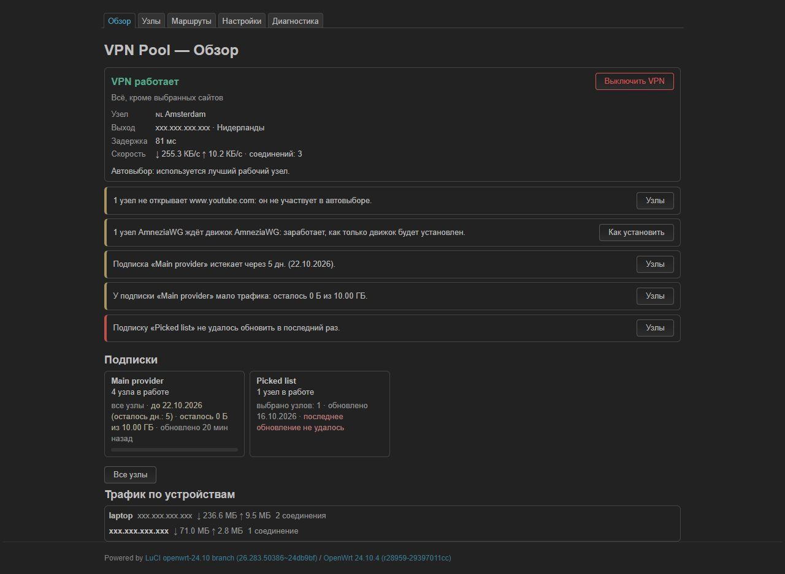
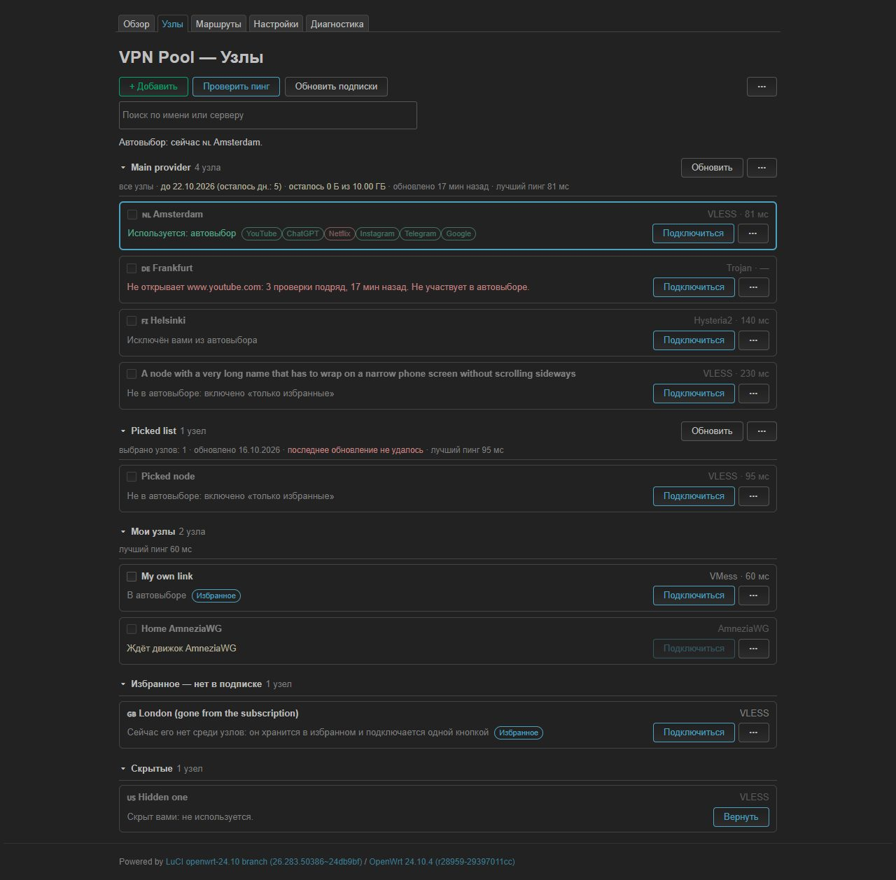
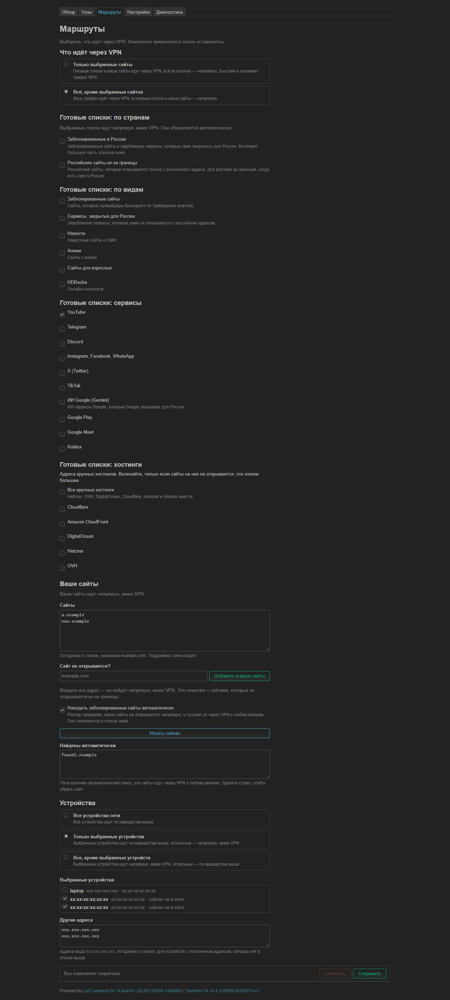
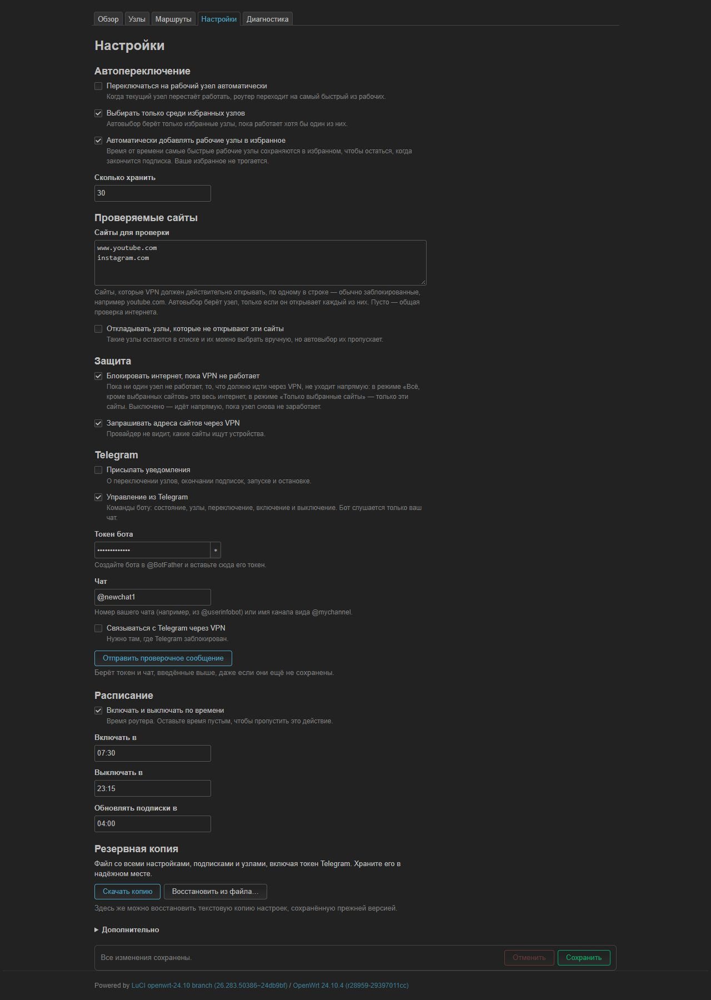
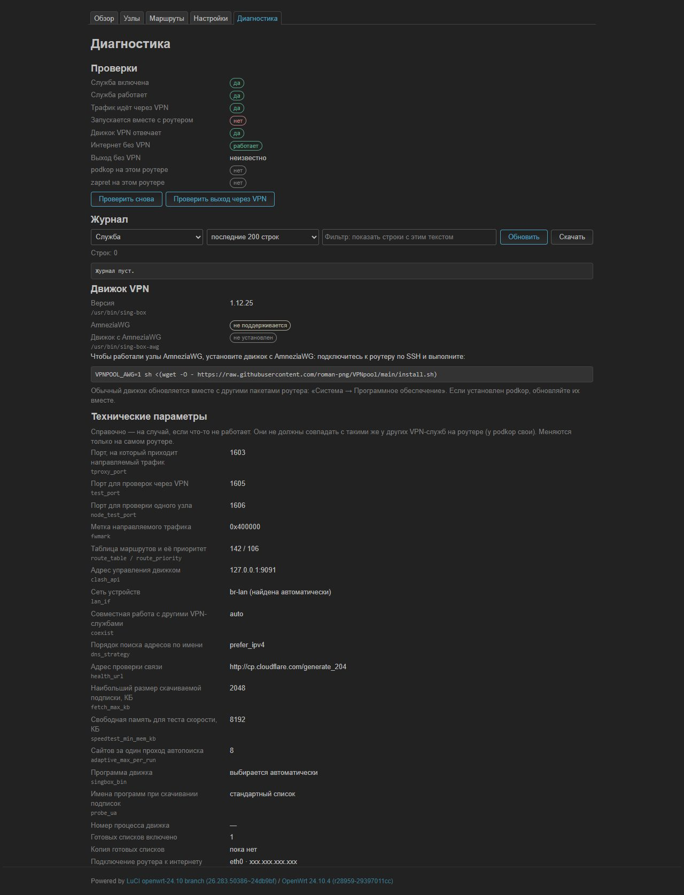
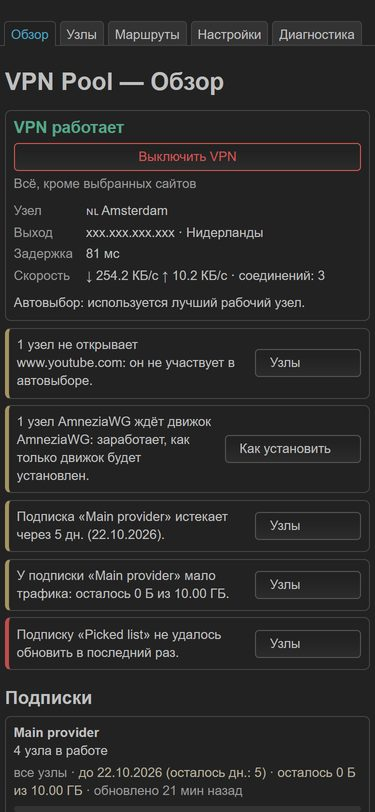
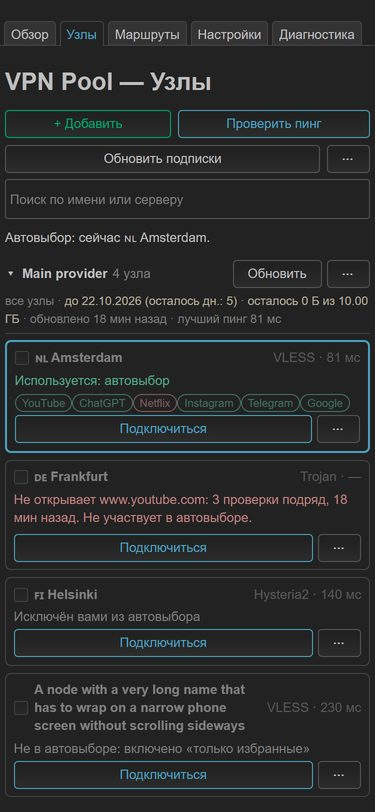
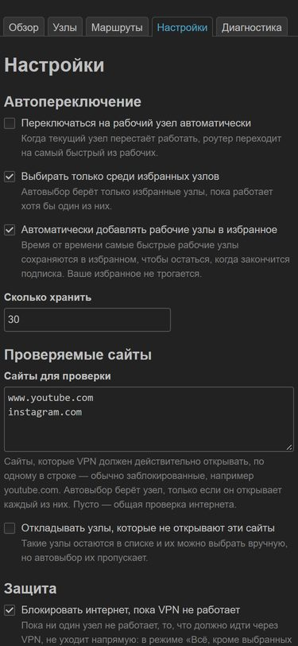

# VPNpool — менеджер подписки VLESS / Reality / Hysteria2 / AmneziaWG с автопереключением для OpenWrt

<p align="right"><a href="README.md">English</a> · <b>Русский 🇷🇺</b></p>

<p align="center">
  <a href="https://github.com/roman-png/VPNpool/actions/workflows/build.yml"></a>
  <a href="https://github.com/roman-png/VPNpool/releases/latest"></a>
  
  
  
  
</p>

**Как v2RayTun или Happ — только на роутере.** vpnpool держит всю вашу подписку VLESS /
Reality как пул, проверяет каждый узел по тем сервисам, которые нужны *вам*, и сам
переключается на рабочий. Узлы AmneziaWG живут в том же пуле. Управление — из LuCI,
Telegram-бота или обычным `uci`.

<p align="center">
  
</p>

```sh
sh <(wget -O - https://raw.githubusercontent.com/roman-png/VPNpool/main/install.sh)
```

<sub>Одна команда для любой OpenWrt: `.apk` на 25.12+, `.ipk` на 23.05 / 24.10 — формат установщик выбирает сам. Другие варианты — в разделе [Установка](#-установка).</sub>

---

## 📸 Скриншоты

Демо-данные на тестовом стенде (выдуманные узлы, адреса скрыты). Язык и тема — как в настройках LuCI.

| **Обзор** | **Узлы** |
|---|---|
|  |  |
| **Маршруты** | **Настройки** |
|  |  |
| **Диагностика** | **На телефоне** |
|  |    |

---

## ✨ Главное

| | |
|---|---|
| 🎯 **Проверка по делу** | Узел «рабочий», только если открывает *ваши* сервисы (например, YouTube), а не просто пингуется |
| 🔀 **Автопереключение** | urltest + сквозной сторож: упавший активный узел заменяется сам |
| 🚦 **Без «чёрной дыры»** | LAN никогда не уходит в мёртвый туннель — нет рабочих узлов, интернет идёт напрямую |
| 📡 **Подписки** | Автообновление, несколько подписок в одном пуле, перебор User-Agent клиентов |
| 🧩 **Протоколы** | VLESS (Reality + Vision), VMess, Trojan, Shadowsocks, Hysteria2, TUIC, JSON sing-box, **AmneziaWG 1.x–3.1** |
| 🧭 **Маршрутизация** | Только выбранные сайты или всё, кроме них; 24 готовых списка; правила по устройствам |
| 🛡️ **Защита от утечек** | IPv6-заслон, kill-switch, защита DNS, анти-DPI фрагментацией TLS |
| 🤖 **Telegram** | Уведомления и бот с кнопками; работает, даже где Telegram заблокирован |
| 📟 **Маленькие роутеры** | Работает на 16 МБ флеш — sing-box живёт в ОЗУ |
| 🤝 **Соседство** | С podkop и zapret: свои метки, таблицы и порты |

---


## 🚀 Установка

**Нужно:** OpenWrt **25.12+** (apk) или **23.05 / 24.10** (opkg), **≥ 128 МБ ОЗУ**,
~40 МБ свободной флеш под sing-box (+ ~45 МБ под [движок AmneziaWG](#-движок-amneziawg), если нужен AmneziaWG) — или
[16 МБ флеш с sing-box в ОЗУ](#-роутеры-с-16-мб-флеш).
Наши пакеты не зависят от архитектуры; sing-box и модули ядра берутся из фидов вашего роутера.

| Вариант | Команда |
|---|---|
| **Обычный** | `sh <(wget -O - https://raw.githubusercontent.com/roman-png/VPNpool/main/install.sh)` |
| **+ AmneziaWG** | `VPNPOOL_AWG=1 sh <(wget -O - https://raw.githubusercontent.com/roman-png/VPNpool/main/install.sh)` |
| **16 МБ флеш** | `VPNPOOL_RAM_SINGBOX=1 sh <(wget -O - https://raw.githubusercontent.com/roman-png/VPNpool/main/install.sh)` |

Та же команда **обновляет** установленный vpnpool; `/etc/config/vpnpool` сохраняется. Если
`wget` не умеет `<(...)`: `wget -O /tmp/i.sh https://raw.githubusercontent.com/roman-png/VPNpool/main/install.sh && sh /tmp/i.sh`.

<details>
<summary><b>Параметры установщика</b></summary>

| Переменная | Что делает |
|---|---|
| `VPNPOOL_AWG=1` | Дополнительно ставит движок AmneziaWG ([vpnpool-engine](https://github.com/roman-png/vpnpool-engine), сверка sha256) отдельным файлом `/usr/bin/sing-box-awg`; стоковый sing-box остаётся как был. `VPNPOOL_AWG=update` обновляет движок |
| `VPNPOOL_RAM_SINGBOX=1` | 16 МБ флеш: sing-box в ОЗУ, переустанавливается при каждой загрузке |
| `VPNPOOL_VERSION=v2.0.0` | Конкретный релиз вместо `latest` (`.apk` — начиная с v1.5.0) |
| `VPNPOOL_PKG_DIR=/tmp/vpnpool` | Поставить файлы пакетов, уже скопированные в этот каталог, — без скачивания с GitHub |

Загрузка повторяется до 4 раз и откатывается на [зеркало GitHub Pages](https://roman-png.github.io/VPNpool).
podkop по-прежнему работает на стоковом `/usr/bin/sing-box`: движок AmneziaWG — отдельный файл.

</details>

<details>
<summary><b>Ручная установка из Releases</b></summary>

В каждом [релизе](https://github.com/roman-png/VPNpool/releases/latest) есть оба формата:

```sh
# OpenWrt 25.12+ (apk)
apk update && apk add --allow-untrusted ./vpnpool-*.apk ./luci-app-vpnpool-*.apk ./luci-i18n-vpnpool-ru-*.apk
# OpenWrt 23.05 / 24.10 (opkg)
opkg update && opkg install ./vpnpool_*_all.ipk ./luci-app-vpnpool_*_all.ipk ./luci-i18n-vpnpool-ru_*_all.ipk
```

`--allow-untrusted` нужен, потому что отдельный файл не покрыт подписью фида. Пакет
`luci-i18n-vpnpool-ru` — русский интерфейс (язык берётся из настроек LuCI).

</details>

<details>
<summary><b>Подписанный фид пакетов</b> — обновляется вместе с системой</summary>

```sh
# OpenWrt 25.12+ (apk)
wget -O /etc/apk/keys/vpnpool-apk.pem https://roman-png.github.io/VPNpool/apk/vpnpool-apk.pem
echo "https://roman-png.github.io/VPNpool/apk/packages.adb" >> /etc/apk/repositories.d/customfeeds.list
apk update && apk add luci-app-vpnpool

# OpenWrt 23.05 / 24.10 (opkg, ключ usign 807479500e0ce219)
wget -O /etc/opkg/keys/807479500e0ce219 https://roman-png.github.io/VPNpool/vpnpool-feed.pub
echo "src/gz vpnpool https://roman-png.github.io/VPNpool" >> /etc/opkg/customfeeds.conf
opkg update && opkg install luci-app-vpnpool
```

Проверка подписи остаётся включённой. Пакет, поставленный из *файла*, закреплён за ним,
поэтому `apk upgrade` / `opkg upgrade` его не обновят — перезапустите установщик или
подключите этот фид.

</details>

<details>
<summary><b>Сборка из исходников (OpenWrt SDK)</b></summary>

```sh
# внутри OpenWrt SDK: 25.12 -> .apk, 24.10 -> .ipk (Makefile'ы одни и те же)
git clone https://github.com/roman-png/VPNpool package/vpnpool-src
./scripts/feeds update -a && ./scripts/feeds install -a
make package/vpnpool/compile package/luci-app-vpnpool/compile V=s
```

CI собирает оба формата под aarch64_cortex-a53, x86_64 и mipsel_24kc и прикладывает к релизам.

</details>

---

## ⚙️ Быстрый старт

1. **Узлы** → **+ Добавить** → вставьте URL подписки → **Проверить** → **Добавить**.
2. **Настройки → Проверка узлов** → перечислите сервисы, которые должны работать (по умолчанию `www.youtube.com`).
3. **Маршрутизация** → выберите режим и списки / домены для прокси.
4. **Обзор** → **Включить**. На вкладке **Узлы** видно, какой узел используется.
5. **Диагностика** → **Проверить выход через VPN** — покажет IP и страну выхода.

```sh
# то же из консоли
uci set vpnpool.sub1=subscription; uci set vpnpool.sub1.url='https://example.com/sub'
uci set vpnpool.main.enabled='1'; uci commit vpnpool
/etc/init.d/vpnpool enable; /etc/init.d/vpnpool restart
```

---

## 🧩 Возможности

**Подписки и узлы**
- Автообновляемая подписка (base64 или JSON sing-box); перебор 9 User-Agent клиентов, пока какой-то не вернёт узлы
- Несколько подписок в одном пуле; офлайн-кэш, если панель недоступна
- Одна кнопка **+ Добавить** для всего: ссылки, адреса подписок, AmneziaWG `.conf` / `vpn://`, файл или
  картинка с QR (расшифровка в браузере); предпросмотр по каждой строке — что добавится и почему нет
- Подписка приносит все узлы или только выбранные; у каждой свой срок, остаток трафика и время
  обновления; **Обновить** обновляет одну подписку
- ⭐ Избранное переживает истечение подписки; скрытые узлы лежат в **Скрытых** и возвращаются одной кнопкой
- Ссылка на узел + **QR без интернета**, экспорт подпиской
- Поиск по имени или серверу и сворачиваемые группы для подписок на сотни узлов

**Проверка и автопереключение**
- 🎯 Один критерий «рабочего» узла: открывает **все** указанные сервисы — по нему работают urltest, failover и сторож
- 🔀 Автопереключение; **Подключиться** — предпочесть узел, **Вернуть автовыбор** — отпустить; узлы можно
  исключить из автовыбора (новые узлы подписок попадают в него сами)
- 🩺 Сквозной сторож перезапускает зависший sing-box; мёртвые хосты отсеиваются заранее
- 🚦 Безопасная маршрутизация: правила поднимаются только после реальной проверки, повтор каждые 15 с
- ⚡ Тест скорости и 🎬 проверка доступа по узлу (YouTube / ChatGPT / Netflix / Instagram / Telegram / Google)

**AmneziaWG** — обфусцированный WireGuard, который проходит DPI мобильных операторов
- Импорт `.conf` или ссылки AmneziaVPN `vpn://` — расшифровывается на роутере, наружу ничего не уходит
- Все поля AWG (Jc/Jmin/Jmax, S1–S4, H1–H4 с диапазонами, I1–I5, PSK, MTU)
- Тот же пул, та же проверка сервисов и автопереключение, что у VLESS
- AmneziaWG 1.x, 2.0 и 3.1 (защита заголовков, диапазоны таймеров, случайные хвосты): движок AmneziaWG
  (`VPNPOOL_AWG=1`, см. [ниже](#-движок-amneziawg)); без него AWG-узлы сохраняются и ждут движок — сборку
  остальных узлов они не ломают

**Маршрутизация**
- Через VPN **только** выбранные списки/домены — или **всё, кроме** них
- 24 автообновляемых списков ([itdoginfo/allow-domains](https://github.com/itdoginfo/allow-domains)) + свои домены
- Правила по устройствам: выбор по имени из DHCP, привязка по MAC
- Адаптивная маршрутизация: сама находит сайты, заблокированные напрямую, и пускает их через VPN
- Анти-DPI: фрагментация TLS ClientHello, выкл / вкл / агрессивно

**Безопасность и управление**
- IPv6-заслон, kill-switch и защита DNS по желанию; Clash API только на loopback
- Каждый конфиг проходит `sing-box check`; битый узел отбрасывается, битая сборка откатывается
- Живой трафик по узлам и устройствам; расписание включения и обновления
- Уведомления в Telegram + двусторонний бот (кнопки `/menu`), ходит через VPN
- «Обзор»: состояние словами, IP и страна выхода, тревоги со ссылкой туда, где это чинится
- «Диагностика» (проверки, журнал с фильтром и скачиванием, технические параметры, версия движка),
  резервная копия / восстановление (в том числе копий 1.x), русский / английский по языку LuCI

---

## 📟 Роутеры с 16 МБ флеш

sing-box (~38 МБ) не помещается, наши пакеты (~128 КБ) — да. С `VPNPOOL_RAM_SINGBOX=1`
vpnpool остаётся во флеш, а sing-box кладётся в ОЗУ при каждом поднятии WAN — роутеру нужен
интернет при загрузке и ~128 МБ ОЗУ. Обновление — повторным запуском той же команды.

<details>
<summary><b>Как это устроено и ручные шаги</b></summary>

- **opkg (≤ 24.10):** пакеты ставятся с `--nodeps`, sing-box — `opkg install -d ram` (`dest ram /tmp`).
- **apk (25.12+):** ни `--nodeps`, ни `-d ram` нет, поэтому зависимость закрывает пустая
  заглушка `apk add --virtual sing-box`, а настоящий бинарь берётся из фида через
  `apk fetch` + `apk extract` в `/tmp/usr/bin/` (`apk fetch` сверяет файл с подписанным индексом фида).

```sh
# 1. мелкие зависимости + наши пакеты без sing-box во флеш
#    apk:
apk add jq curl ucode ucode-mod-fs ucode-mod-uci kmod-nft-tproxy ip-full luci-base ca-bundle kmod-tun kmod-inet-diag zram-swap
apk add --virtual sing-box
apk add --allow-untrusted ./vpnpool-*.apk ./luci-app-vpnpool-*.apk
#    opkg:
opkg install jq curl ucode ucode-mod-fs ucode-mod-uci kmod-nft-tproxy ip-full luci-base ca-bundle zram-swap
opkg install --nodeps ./vpnpool_*_all.ipk ./luci-app-vpnpool_*_all.ipk

# 2. без автозапуска — vpnpool запустит хук, когда sing-box окажется в ОЗУ
/etc/init.d/vpnpool disable
```

```sh
# 3. хук загрузки (вариант для apk; на opkg замените строки apk на
#    "opkg update" + "opkg install -d ram --force-reinstall --force-overwrite sing-box")
cat > /etc/hotplug.d/iface/99-vpnpool-singbox-ram <<'EOF'
#!/bin/sh
[ "$ACTION" = "ifup" -a "$INTERFACE" = "wan" ] && {
    apk update
    d=/tmp/vpnpool-sb; rm -rf "$d"; mkdir -p "$d/x" /tmp/usr/bin
    apk fetch -o "$d" sing-box && apk extract --allow-untrusted --destination "$d/x" "$d"/sing-box-[0-9]*.apk \
        && mv -f "$d/x/usr/bin/sing-box" /tmp/usr/bin/sing-box
    rm -rf "$d"; chmod +x /tmp/usr/bin/sing-box
    ln -sf /tmp/usr/bin/sing-box /usr/bin/sing-box
    /etc/init.d/vpnpool start
    logger -t vpnpool "sing-box in RAM, vpnpool started"
}
EOF
chmod +x /etc/hotplug.d/iface/99-vpnpool-singbox-ram
```

Хук должен быть **один**: два хука одновременно на роутере со 128 МБ портят бинарь
(`sing-box: Bus error`). С `VPNPOOL_AWG=1` хук кладёт в ОЗУ и движок AmneziaWG (только на роутерах
с ОЗУ от 256 МБ) и при неудаче оставляет стоковый sing-box. Проверено на Xiaomi Mi Router 4A Gigabit (16 МБ / 128 МБ, OpenWrt 24.10);
путь через apk — на официальном образе OpenWrt 25.12.4.

</details>

---

## 📚 Справочник

<details>
<summary><b>Как это работает</b></summary>

```
LuCI (5 вкладок) ── ubus/rpcd ── vpnpoold (ucode + shell, procd)
                                  │ загрузка (перебор UA) → разбор → сборка → sing-box check
                                  │ проверка сервисов (Clash delay API) → живые/мёртвые
                                  ▼
            sing-box (стоковый; /usr/bin/sing-box-awg, если в пуле есть AmneziaWG)
   вход   : tproxy 127.0.0.1:1603  +  локальный SOCKS/HTTP :1605 (проверка выхода, бот)
            + :1606 (проверка узлов по одному)
   выход  : urltest "auto" (пинг + failover) + селектор + узлы + direct
   endpoints[]: пиры AmneziaWG / WireGuard (sing-box >= 1.13)
   правила: SNI → списки SRS / домены → proxy (или direct в режиме «всё, кроме»)
                                  ▲
   nftables (table inet vpnpool): метка LAN 80/443 → fwmark 0x400000 → таблица 142 →
   tproxy; уступает podkop; IPv6 закрыт; включение/исключение устройств
```

Управляющая часть наша, передачу данных делает sing-box. Маршрутизация — по SNI, без
fake-IP и без перехвата dnsmasq.

</details>

<details>
<summary><b>Настройки (uci) — все параметры</b></summary>

Всё хранится в `/etc/config/vpnpool`, секция `config vpnpool 'main'`.

| Параметр | По умолчанию | Смысл |
|---|---|---|
| `enabled` | `0` | Запуск службы (переключатель в LuCI) |
| `mode` | `selective` | `selective` — через VPN только списки; `exclude` — всё, кроме них |
| `subscription_interval` | `6h` | Период автообновления |
| `check_services` | `www.youtube.com` | **Главный** критерий рабочего узла, по хосту в строке |
| `health_url` | `http://cp.cloudflare.com/generate_204` | Запасная проверка, если `check_services` пуст |
| `failover_interval` / `failover_tolerance` | `60` / `50` | Интервал urltest (с) и допуск (мс) |
| `auto_switch` | `1` | `0` закрепляет селектор на первом узле |
| `preferred_node` | — | «Подключиться»: мягкое предпочтение (id узла) с переключением при сбое и возвратом; пусто — автовыбор |
| `favorites_only` | `0` | Автовыбор только среди избранных узлов |
| `dead_filter` / `dead_filter_strikes` / `dead_filter_tries` | `1` / `3` / `3` | Фильтр авто-пула по сервисам, провалов до исключения, повторов за цикл |
| `ipv6` | `block` | `block` — IPv6 закрыт; `off` — IPv6 не трогаем |
| `killswitch` / `dns_protect` | `0` / `0` | Закрытый IPv4 в режиме `exclude` / DNS LAN через туннель |
| `client_mode` | `all` | `all` / `exclude` / `include` по устройствам |
| `antidpi` | `off` | `off` / `on` (`tls_fragment`) / `aggressive` (+ `tls_record_fragment`) |
| `adaptive_routing` / `adaptive_max_per_run` | `0` / `8` | Поиск доменов, заблокированных напрямую |
| `auto_snapshot` / `auto_snapshot_max` | `0` / `20` | Автоматически добавлять рабочие узлы в избранное |
| `sched_enabled`, `sched_on`, `sched_off`, `sched_refresh` | `0`, — | Расписание на день (ЧЧ:ММ) |
| `telegram_enabled`, `telegram_token`, `telegram_chat` | `0`, — | Уведомления |
| `telegram_control` / `telegram_via_proxy` | `0` / `1` | Двусторонний бот / Telegram через туннель |
| `speedtest_url` / `speedtest_min_mem_kb` | Cloudflare / `8192` | Адрес теста скорости / запас свободной памяти |
| `dns_strategy` | `prefer_ipv4` | Порядок разрешения имён для проверок sing-box |
| `fwmark` / `route_table` / `route_priority` | `0x400000` / `142` / `106` | Непересекающиеся ресурсы маршрутизации |
| `tproxy_port` / `test_port` / `node_test_port` / `clash_api` | `1603` / `1605` / `1606` / `127.0.0.1:9091` | Входы (tproxy, проверка выхода и бот, проверка узлов) и управляющий API |
| `lan_if` / `coexist` / `log_level` | авто / `auto` / `warn` | Устройство LAN, уступка podkop, уровень лога sing-box |
| `schema` | `2` | Версия формата этого файла (ставит миграция 1.x → 2.0; не править) |

Списки, которые ведёт приложение: `manual_node` (ваши ссылки), `hidden`, `auto_exclude` (исключены
из автовыбора; остальные участвуют, новые тоже), `auto_member` (1.x: участвуют только эти),
`keep_auto` (id узлов), `client`, `client_dev`, `probe_ua`; в `config routing 'routing'` —
`community`, `domain`, `auto_domain`. Каждая подписка — своя секция `config subscription` с
`url`, `name`, `enabled` и `mode` (`all` — все узлы, `pick` — только id из `list pick`).
Избранное — `/etc/vpnpool/favorites.map.json`. Настройки 1.x при установке переводятся в этот
вид (копия старых — в `/etc/vpnpool/backup-1.x/`).
Узлы AmneziaWG — файлы `/etc/vpnpool/awg/*.conf`.

</details>

<details>
<summary><b>Сравнение с podkop / passwall2 / homeproxy</b></summary>

| | **vpnpool** | podkop | passwall2 | homeproxy |
|---|---|---|---|---|
| Автопинг + переключение | ✅ urltest + сторож | вручную | ✅ | ✅ |
| Проверка узлов по реальным сервисам | ✅ | — | только пинг | только пинг |
| Безопасная маршрутизация | ✅ | — | — | — |
| Предпочтительный узел с возвратом | ✅ | — | — | — |
| AmneziaWG в том же пуле | ✅ `.conf` + `vpn://` | — | — | — |
| Трафик подписки, избранное, тесты скорости / доступа | ✅ | — | — | — |
| Двусторонний Telegram-бот | ✅ | — | — | — |
| Адаптивная маршрутизация, анти-DPI | ✅ | — | — | — |
| Готовые списки SRS | ✅ 24 | ✅ | свои | свои |
| Правила по устройствам | ✅ имя DHCP / MAC | — | ✅ | частично |
| Соседство с podkop | ✅ | — | — | — |

</details>

<details>
<summary><b>Частые вопросы</b></summary>

- **Это VPN-сервис?** Нет — подписка, сервер или конфиг AmneziaWG ваши.
- **Чем отличается от podkop?** podkop маршрутизирует выборочно, но узел выбираете вы; vpnpool выбирает и переключает узлы сам. Они работают рядом.
- **Нужен другой sing-box?** Только для AmneziaWG (`VPNPOOL_AWG=1` ставит движок AmneziaWG рядом со стоковым).
- **200 узлов на дешёвом роутере?** Нормально: мёртвые хосты отсеиваются, проверки идут по очереди, тяжёлые тесты смотрят на свободную память.
- **Подписка истекла / все узлы лежат?** LAN остаётся на прямом подключении; маршрутизация вернётся в течение 15 с после ответа узла.
- **Без LuCI?** Да — `uci` и Telegram-бот.
- **zapret?** Уживается, виден в диагностике; vpnpool им не управляет.

</details>

<details>
<summary><b>Если что-то не работает</b></summary>

| Симптом | Что делать |
|---|---|
| В логе *«keeping LAN on DIRECT»* | Ни один узел не прошёл проверку — проверьте подписку и *Настройки → Проверка узлов* |
| Всё пингуется, сайты не открываются | Узел достаёт до CDN, но не до ваших сервисов — смотрите список **«Вне авто-пула»** |
| AmneziaWG-узел «ждёт движок» | Движок AmneziaWG не установлен — запустите установщик с `VPNPOOL_AWG=1` (движок виден в «Диагностике») |
| `sing-box: Bus error` после перезагрузки (16 МБ) | Два хука загрузки — оставьте один |
| Не скачиваются списки доменов | Они берутся с GitHub Releases — сначала пустите GitHub через прокси |
| Бот отвечает через раз | Работают два поллера — остановите ручной `tgbot.sh` |
| `no .apk assets in release` | Этот релиз старше поддержки apk — `.apk` есть с v1.5.0 |
| `UNTRUSTED signature` при `apk add ./файл.apk` | Добавьте `--allow-untrusted` или подключите подписанный фид |

```sh
logread -e vpnpool                       # лог
uci show vpnpool                         # конфигурация
/etc/init.d/vpnpool restart              # перезапуск
kill -USR2 $(cat /var/run/vpnpool.pid)   # заново скачать подписку и пересобрать
```

Ограничения: ECH (зашифрованный SNI) не распознаётся; анти-DPI — только фрагментация TLS, против ТСПУ используйте zapret.

</details>

---

## 🧬 Движок AmneziaWG

Стоковый sing-box не умеет AmneziaWG, поэтому у vpnpool своя сборка: [vpnpool-engine](https://github.com/roman-png/vpnpool-engine)
— upstream sing-box с патчем AmneziaWG (amneziawg-go 3.1); релизы неизменяемые, с суммами sha256.

- **Установка / обновление:** `VPNPOOL_AWG=1` (или `=update`) в установщике либо
  `/usr/libexec/vpnpool/engine.sh install|update|status|restore-stock`. Перед заменой проверяются sha256,
  версия и настоящий конфиг AmneziaWG; при любой ошибке рабочий бинарь остаётся.
- **Где:** `/usr/bin/sing-box-awg`, отдельный файл. vpnpool запускает его, только когда в пуле есть
  AmneziaWG-узлы; podkop и остальное работают на стоковом `/usr/bin/sing-box`.
- **Архитектуры:** aarch64, arm_cortex-a7, mipsel_24kc, mips_24kc, x86_64.
- **Память:** бинарь ~45 МБ. На роутерах с 16 МБ флеша он живёт в ОЗУ (нужно от 256 МБ ОЗУ; скачивается
  заново при загрузке), установщик заранее проверяет место и память.

## 🗺️ Планы

Более быстрое переключение по активной проверке · DNS/FakeIP с DoH через прокси · полный
IPv6 tproxy · подписки Clash YAML · цепочки узлов · AmneziaWG для других архитектур

## 🛠️ Разработка

ucode + shell + немного LuCI JS — компилировать нечего. В `package/` — два пакета, в
`stand/` — Docker-стенд на настоящем rootfs OpenWrt, `scripts/deploy.sh` выкладывает файлы
на роутер по SSH, `tools/router-smoke-test.sh` проверяет живой роутер без изменений.
Issues и PR приветствуются.

## 📄 Лицензия

[GPL-3.0-only](LICENSE) © 2026 roman-png

<sub>OpenWrt VLESS Reality · менеджер подписки sing-box · автопереключение VPN на роутере ·
v2RayTun / Happ для роутера · альтернатива podkop / passwall / homeproxy · AmneziaWG OpenWrt ·
OpenWrt 25.12 apk · обход блокировок роутер OpenWrt · подписка VLESS на роутер · AmneziaWG на роутер</sub>
